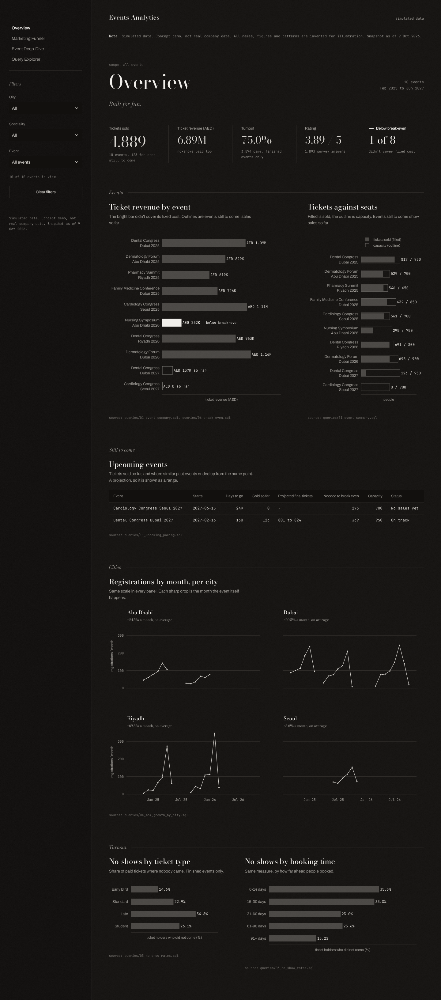
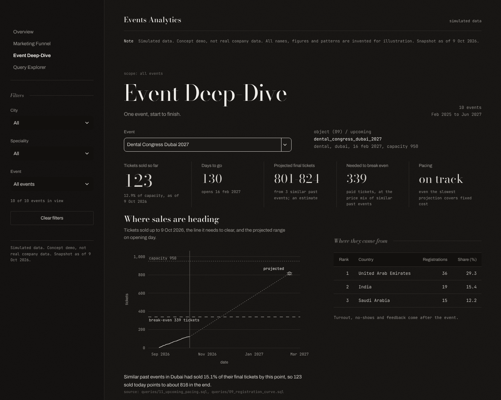
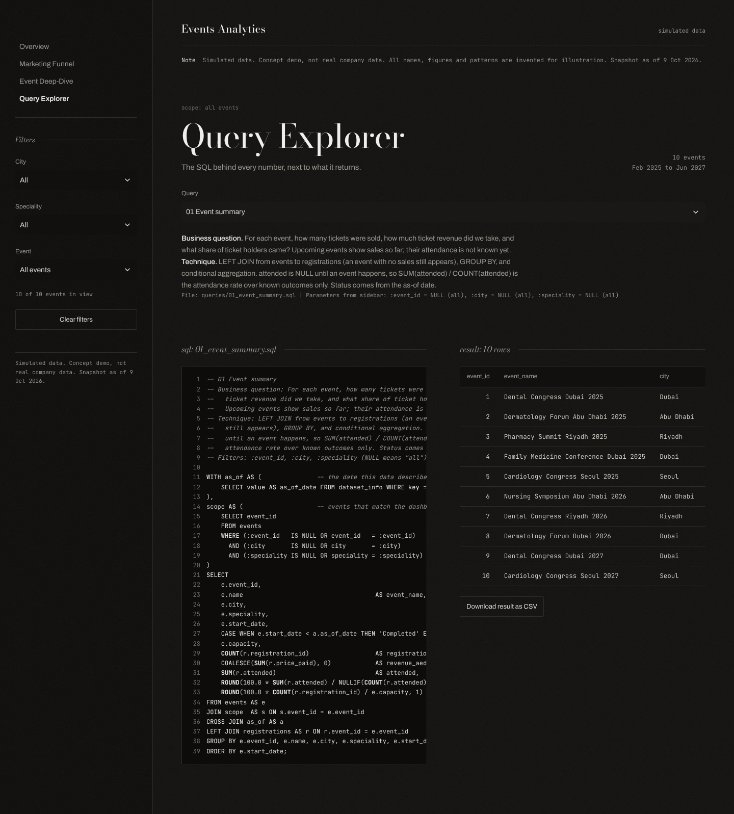
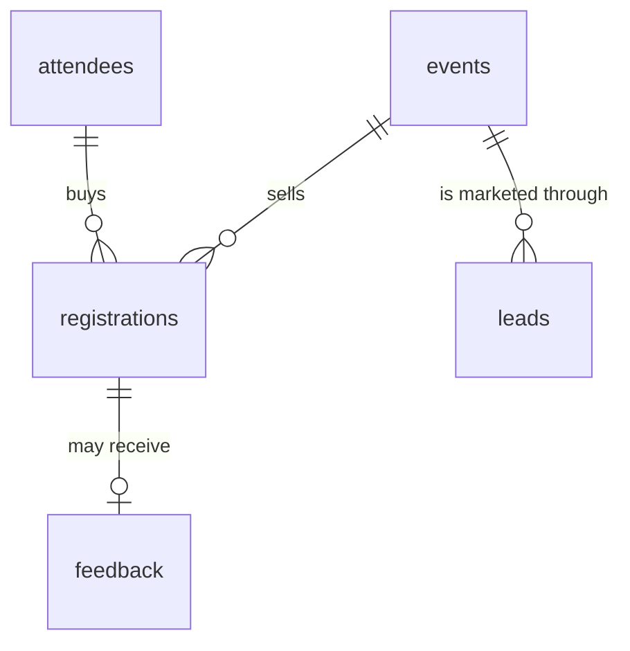

# Events Analytics

Built for fun.

> **Simulated data. Concept demo, not real company data.**
> Every event, person and number in the demo database is made up. It shows how a medical-conference organiser could keep track of sales and turnout. It says nothing about any real company. The project can also load real exports; when it does, every page says where the data came from instead.

How I built it: [PLACEHOLDER: in your own words, including any tools you used, for example an AI coding assistant].

## What it is

A conference organiser sells tickets and hopes people show up. Most of that data sits in exports nobody reads. This project puts it in one place and asks plain questions of it:

- Which channels bring people who actually come?
- Which buyers pay and don't turn up?
- Did each event cover its costs?
- Are the next ones selling fast enough?

It has a SQLite database, eleven SQL queries with comments, a four-page Streamlit dashboard built straight on those queries, a one-page brief written from the same results, and a loader for real CSV exports.

Every number on screen and in the brief comes from a `.sql` file in `queries/`. The Query Explorer page shows each file next to what it returns.

## Screenshots

The Overview. Money per event, with the one event that didn't break even in bright silver.



An event that hasn't happened yet: tickets sold so far, the line it needs to clear, and a projected range.



The Query Explorer. The SQL on the left, its result on the right.



## Run it

Python 3.11 or newer.

```bash
pip install -r requirements.txt && python generate_data.py && streamlit run app.py
```

Then open http://localhost:8501. If the demo database is missing, the app builds it on first launch.

```bash
python -m pytest                   # the test suite
python make_brief.py               # rewrite findings_brief.md from the query results
python generate_data.py --seed 7   # a different simulated world, still reproducible
```

## Using your own data

```bash
python load_csv.py --templates templates/        # empty CSVs with the right headers, plus COLUMNS.md
python load_csv.py exports/ --as-of 2026-10-09 --name "CRM export, Oct 2026"
EVENTS_DB=data/loaded.db streamlit run app.py    # Windows: set EVENTS_DB=data\loaded.db, then streamlit run app.py
```

It needs `events.csv`, `attendees.csv` and `registrations.csv`. `leads.csv` and `feedback.csv` are optional.

The loader checks everything before it writes anything. Problems are listed by file and row in `data/loaded.load_report.md`, all in one pass. It doesn't guess: `03/04/2026` is refused rather than read as March or April, and a blank attendance stays unknown instead of becoming a no-show.

Loaded data is labelled as loaded on every page. The demo generator won't overwrite it. If `EVENTS_DB` points at a missing file, the app stops and says so instead of showing made-up numbers.

`python load_csv.py --export-demo demo_csv/` writes the demo in the same format. A test exports it, loads it back, and checks that all eleven queries give the same answers.

## What's in the repo

```
app.py                  Streamlit entry point: stylesheet, filters, data-source note, page navigation
views/                  Overview, Marketing Funnel, Event Deep-Dive, Query Explorer (why not pages/: see below)
lib/db.py               Opens the database and runs queries/*.sql
lib/charts.py           Plotly charts (drawing only, no analysis)
lib/theme.py            Colours, number formats, the shared chart template
lib/ui.py               Headline numbers, chart cards, tables, filters, notes
assets/style.css        All the styling, in one file
static/fonts/           Bundled fonts (Latin subsets, SIL Open Font License)
db/schema.sql           Tables, keys, constraints and indexes
generate_data.py        Seeded simulator (standard library only)
load_csv.py             Loader for real CSV exports (standard library only)
queries/                One commented .sql file per question
make_brief.py           Writes findings_brief.md from the query results
findings_brief.md       One-page brief for a non-technical reader
tests/                  pytest suite
data/events.db          The simulated demo database
```

## Data model



| Table | One row per | Main columns |
|---|---|---|
| `dataset_info` | fact about the data | `source` (simulated or loaded), `source_name`, `as_of_date` |
| `events` | conference | `event_id`, name, speciality, city, start_date, capacity, base_ticket_price, fixed_cost, sponsorship_revenue (blank = not recorded) |
| `attendees` | person | `attendee_id`, country, profession, registered_first_date |
| `registrations` | ticket sold | `registration_id`, `event_id`, `attendee_id`, registered_on, ticket_type, price_paid, channel, attended (1, 0, or blank until the event happens) |
| `leads` | sales contact | `lead_id`, `event_id`, contacted_on, channel, outcome, follow_ups |
| `feedback` | survey answer | `feedback_id`, `registration_id`, rating 1 to 5, comment_theme |

An event is finished if it started before the as-of date. Otherwise it's upcoming. That's worked out when you ask, never stored, so it can't go stale.

`attended` stays blank (NULL) until an event happens. SQL skips NULLs when it counts, so rates divide by `COUNT(attended)`, not `COUNT(*)`. That way a ticket for next year never counts as a no-show.

City, speciality, channel, ticket type and feedback theme are free text, so a new city or a website channel loads without touching the schema. Things with a fixed meaning (attended, rating, lead outcome, prices) stay checked.

### The demo data

`generate_data.py` builds 10 events in Dubai, Abu Dhabi, Riyadh and Seoul, as of 9 Oct 2026. Eight are finished (February 2025 to September 2026). Two are still to come: one on sale with 123 tickets, one announced with none. 4,889 tickets, 8,434 leads, 1,893 survey answers in all.

One seeded random generator drives it, so the same seed gives the same database. A few patterns are built in, so the analysis has something to find. The levers are constants at the top of the file. There's random noise on top, so nothing comes out perfectly clean.

Tests check the simulator never breaks its own rules. Nobody buys a ticket after the event starts, and nothing happens after the as-of date. Finished events have known turnout; upcoming ones don't. Price matches ticket type (Early Bird 0.8, Standard 1.0, Late 1.2, Student 0.5 of base). Only students get Student tickets, and only people who came leave feedback. Every ticket traces back to a lead, and nobody buys two tickets to the same event.

## How filtering works

Every query starts with the same short CTE:

```sql
WITH scope AS (               -- events that match the dashboard filters
    SELECT event_id
    FROM events
    WHERE (:event_id   IS NULL OR event_id   = :event_id)
      AND (:city       IS NULL OR city       = :city)
      AND (:speciality IS NULL OR speciality = :speciality)
)
```

The sidebar sends its choices as named parameters. "All" is sent as `NULL`, which switches that line off. The SQL is never rewritten in Python; the same file runs in the app, the tests and the brief.

## The queries

| File | Question | How |
|---|---|---|
| `01_event_summary.sql` | Tickets, revenue, turnout and status per event | LEFT JOIN, GROUP BY, `SUM(attended) / COUNT(attended)` |
| `02_channel_funnel.sql` | Leads, then tickets, then turnout, per channel | Two CTEs, plus a UNION of their channels so none drop out |
| `03_no_show_rates.sql` | No-shows by ticket type and by booking time | `julianday()` maths, CASE buckets, UNION ALL |
| `04_mom_growth_by_city.sql` | Month-on-month registration growth per city | `LAG()` per city, a check that months are consecutive |
| `05_top_countries.sql` | Top 3 countries per event | `ROW_NUMBER() OVER (PARTITION BY event)`, windowed `SUM()` |
| `06_break_even.sql` | Paid tickets needed to cover fixed cost | Chained CTEs, a hand-made ceiling, a status that always matches the margin |
| `07_feedback_by_ticket.sql` | Rating and top complaint by ticket type | `ROW_NUMBER()` over an aggregate, join on rank 1 |
| `08_kpi_summary.sql` | Headline numbers | Three one-row aggregates joined with CROSS JOIN |
| `09_registration_curve.sql` | How tickets built up, day by day | Running total with `SUM() OVER (ORDER BY day)` |
| `10_feedback_themes.sql` | What people commented on | GROUP BY theme, `SUM(COUNT(*)) OVER ()` for share |
| `11_upcoming_pacing.sql` | Is each upcoming event selling fast enough? | `ROW_NUMBER()` picks the three most recent similar events; a projected range |

Queries 01 to 07 answer the original questions. 08 to 11 exist so the headline numbers, sales curves, feedback chart and pacing view also come from SQL, not pandas.

## What broke, and what changed

The project was reviewed by trying to break it. Every headline number was checked by hand in pandas. The data was rebuilt under 40 random seeds, and every page was loaded under every filter. It was fed awkward databases, scaled up 41 times, and opened from awkward folders. Five things broke. Each fix has a test in `tests/test_break_points.py` that recreates the original failure.

| Problem | Fix | Result |
|---|---|---|
| 120 tickets for an event that hadn't happened counted as no-shows. Early Bird no-shows jumped from 14.6% to 23.1%, and an event with no sales crashed its page. | Turnout stays blank until an event happens. Upcoming events get a pacing view instead of a verdict. | 123 pre-sold tickets change nothing: Early Bird stays at 14.6%. The no-sales event says "no sales yet". |
| A new city was rejected. Website sign-ups with no sales lead vanished from the funnel (680 of 4,766). The banner always said "simulated", and a missing database was quietly replaced with fake data. | A CSV loader that checks every row, open text fields, a funnel that keeps every channel, and a banner that reads the data source. | New cities load. 0 tickets missing from the funnel. Real data is never overwritten or swapped out. |
| Break-even compared people who came with a target based on tickets sold. In 5 of 40 test worlds a profitable event was called a loss. | Break-even is counted in paid tickets, because no-shows paid too. | 0 contradictions in 40 worlds. |
| With 328 events the Overview was 22 screens long, and one table was a 9.6 MB page. | Long lists show 12 events, with a caption saying exactly which. Tables show 200 rows a page. | 330 events: 4 screens. The table is 0.1 MB. |
| The database wouldn't open from a folder like "Projects #2". | The file path is encoded properly before opening. | #, ?, %, spaces and Arabic folder names all work. |

### Still not handled

- Takeaway lines compare channels without checking sample size. For the Nursing Symposium alone, the WhatsApp vs Cold Call gap (15.4 points) could be anywhere from -1.6 to +32.4. Across all events the gap is real.
- There's no marketing spend in the data, so "move effort to WhatsApp" can't be judged on cost.
- Pacing assumes this year sells like the last three editions in the same city. It's shown as a range for that reason.
- The two no-show views overlap, because ticket type mostly follows booking date.
- All prices are in AED, Seoul included. There's no login. Printing gives dark pages.

## The look

Warm near-black, brushed silver, 1px hairlines and a little matte grain. No accent colour; a test keeps it that way. The one thing on a page that needs attention is polished silver and named in words.

Bodoni Moda for headlines and big numbers, Archivo for text, JetBrains Mono for tables and axes. All three are bundled, so it looks the same offline. Charts share one template: AED on money, one decimal on percentages, a title and one line on what to look at.

Why `views/` and not `pages/`: Streamlit treats a `pages/` folder specially. On a fresh server, a link straight to `/event_deep_dive` would skip `app.py`, and with it the styling and the data-source note. A test keeps it that way.

## Talking points

Two sentences per query, for explaining it out loud.

| Query | What to say |
|---|---|
| 01 Event summary | One row per event with tickets, revenue, turnout and status. It divides by `COUNT(attended)`, which only counts known outcomes, so next year's tickets never show up as no-shows. |
| 02 Channel funnel | Leads and tickets live in different tables, so each gets its own CTE, and the channel lists are joined with a UNION first. Website sign-ups with no sales lead still count instead of falling out. |
| 03 No-show rates | `julianday()` gives days between booking and the event, CASE puts them in buckets, and UNION ALL stacks the two views so one query feeds two charts. Tickets with unknown turnout are left out. |
| 04 Growth by city | LAG puts last month's count on the same row, per city. Growth is only worked out between consecutive full months with at least 20 registrations, because a gap, a tiny first month or the current part-month would give nonsense. |
| 05 Top countries | ROW_NUMBER ranks countries inside each event and keeps the top three. A windowed SUM turns each count into a share, which is what you'd use to decide where to spend on visas or partner societies. |
| 06 Break-even | Break-even is the number of paid tickets needed to cover fixed cost after any recorded sponsorship, since no-shows paid too. An earlier version compared people who came, and it called profitable events losses in 5 of 40 test worlds. |
| 07 Feedback by ticket type | One CTE ranks themes inside each ticket type, another gets the average rating and the share about price, and they join on rank one. It separates a price complaint from a quality complaint, which changes who should act. |
| 08 Headline numbers | Events, tickets and survey answers are each totalled on their own, then cross-joined. Joining feedback to tickets first would make revenue depend on who filled in the survey. |
| 09 Registration curve | A running total turns daily sales into a curve against capacity. The pacing view is built on it. |
| 10 Feedback themes | GROUP BY theme, with `SUM(COUNT(*)) OVER ()` for each theme's share in one pass. Share plus average rating shows how often a topic comes up and how unhappy people are when it does. |
| 11 Upcoming pacing | For each upcoming event, it finds the three most recent finished events in the same city and checks how much of their final sales they had at the same number of days out. Sold so far divided by that share gives a projection, and the fastest and slowest of the three give the range. |
